# Gnn Baseline Model Results

Here are the latest results after running the baseline gnn model on the `ssp245` test scenario.

### Kaggle Score

| Metric | Score |
|---|---|
| nNSE (↑) | -0.482596 |

### Quantitative Results

| Variable                             |     R² |
|:-------------------------------------|-------:|
| `tas` (Near-Surface Air Temperature) |  0.545 |
| `tasmax` (Daily Max Temperature)     |  0.514 |
| `tasmin` (Daily Min Temperature)     |  0.534 |
| `pr` (Precipitation)                 | -0.084 |
| `huss` (Specific Humidity)           |  0.467 |
| `psl` (Sea Level Pressure)           |  0.176 |
| `sfcWind` (Surface Wind Speed)       |  0.121 |

**Climate Extreme Indices Metrics:**

| Index   | Description                   | Unit     | RMSE           |       R2 |
|:--------|:------------------------------|:---------|:---------------|---------:|
| FD      | Frost Days                    | days     | 10.228 days    |   -4.46  |
| SU      | Summer Days (Tmax ≥ 25°C)     | days     | 11.395 days    |   -0.563 |
| ID      | Ice Days (Tmax < 0°C)         | days     | 8.987 days     |   -1.255 |
| TR      | Tropical Nights (Tmin ≥ 20°C) | days     | 9.308 days     |   -0.412 |
| GSL     | Growing Season Length         | days     | 12.083 days    |   -0.382 |
| TXX     | Monthly Max of Daily Tmax     | °C       | 4.157 °C       |   -0.481 |
| TNN     | Monthly Min of Daily Tmin     | °C       | 4.195 °C       |   -0.327 |
| WSDI    | Warm Spell Duration Index     | days     | 94.055 days    |  -56.336 |
| CSDI    | Cold Spell Duration Index     | days     | 3.331 days     |   -0.129 |
| RX5DAY  | Max 5-day Precipitation       | mm       | 34.589 mm      |   -2.17  |
| CDD     | Consecutive Dry Days          | days     | 202.794 days   | -916.76  |
| CWD     | Consecutive Wet Days          | days     | 85.508 days    | -609.721 |
| R95P    | Total Precip above 95th pct   | mm       | 330.374 mm     |   -9.783 |
| SDII    | Simple Daily Intensity Index  | mm day⁻¹ | 4.448 mm day⁻¹ |  -63.006 |
| R10MM   | Days with Precip ≥10mm        | days     | 22.533 days    |  -11.731 |

### Visual Results

Below are all visuals from `gnn_visuals/`. To avoid revealing the held-out SSP2-4.5 targets, the maps show only the baseline predictions; index maps add each AR6 land region's nNSE over 2015–2100, as used by the leaderboard metric.
#### Daily Prediction Maps (2015-02-20)

<table>
  <tr>
<td align="center"><b>result_map_huss_2015-02-20.png</b></td>
<td align="center"><b>result_map_pr_2015-02-20.png</b></td>
  </tr>
  <tr>
<td>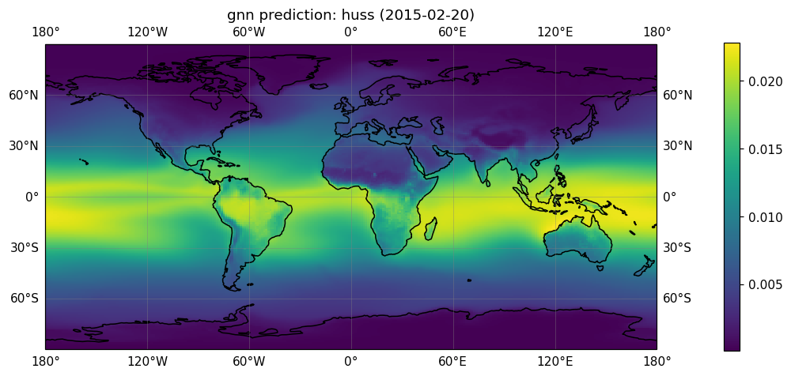</td>
<td>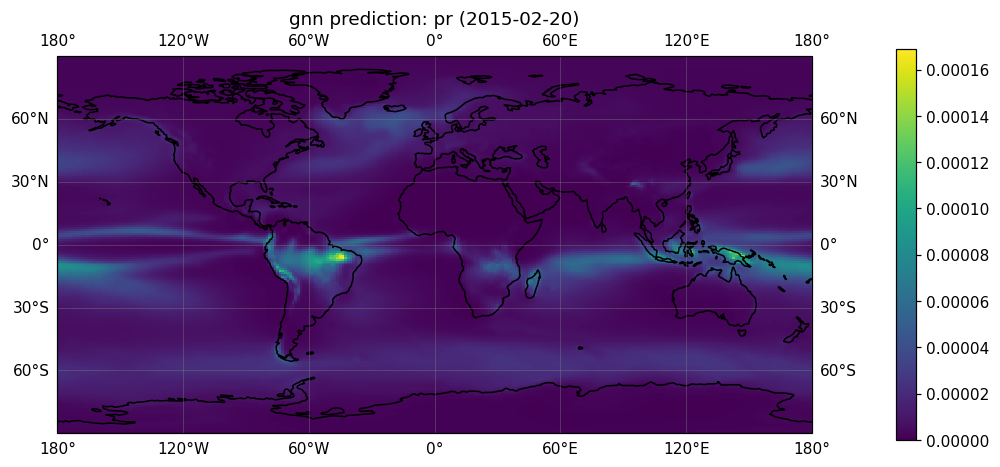</td>
  </tr>
  <tr>
<td align="center"><b>result_map_psl_2015-02-20.png</b></td>
<td align="center"><b>result_map_sfcWind_2015-02-20.png</b></td>
  </tr>
  <tr>
<td>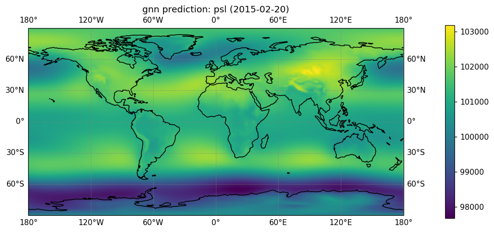</td>
<td>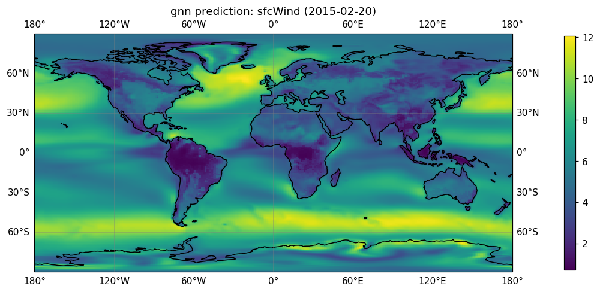</td>
  </tr>
  <tr>
<td align="center"><b>result_map_tas_2015-02-20.png</b></td>
<td align="center"><b>result_map_tasmax_2015-02-20.png</b></td>
  </tr>
  <tr>
<td>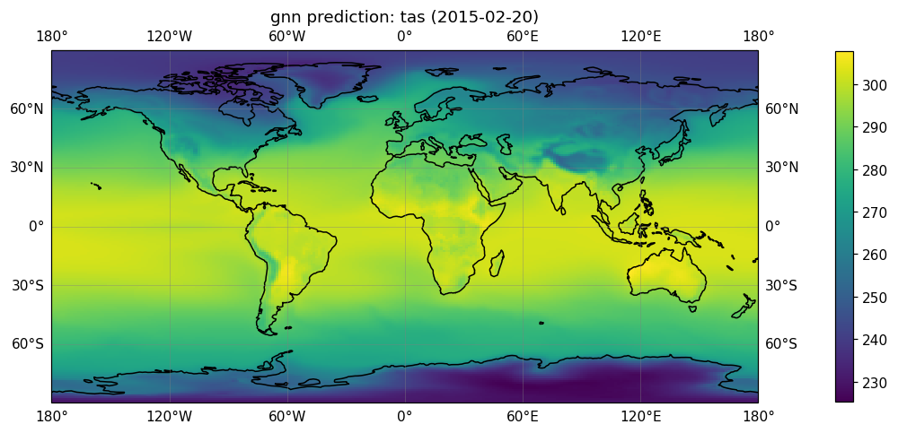</td>
<td>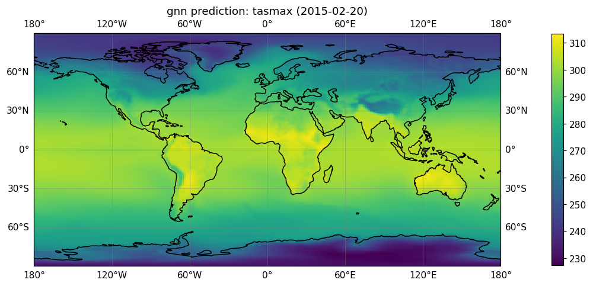</td>
  </tr>
  <tr>
<td align="center"><b>result_map_tasmin_2015-02-20.png</b></td>
<td align="center"></td>
  </tr>
  <tr>
<td>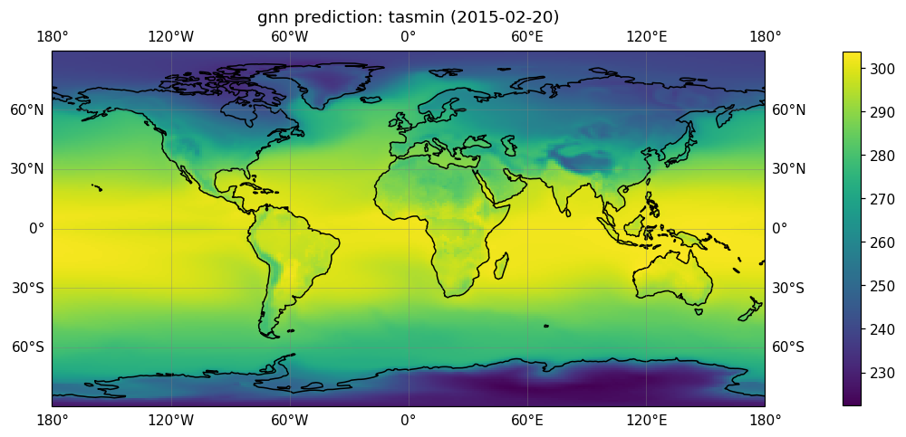</td>
<td></td>
  </tr>
</table>

#### Index Maps

<table>
  <tr>
<td align="center"><b>index_map_CDD_2065-01-01.png</b></td>
<td align="center"><b>index_map_CSDI_2065-01-01.png</b></td>
  </tr>
  <tr>
<td>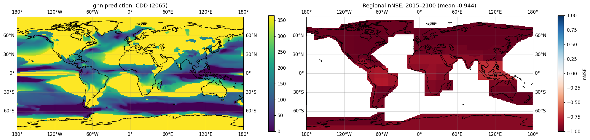</td>
<td>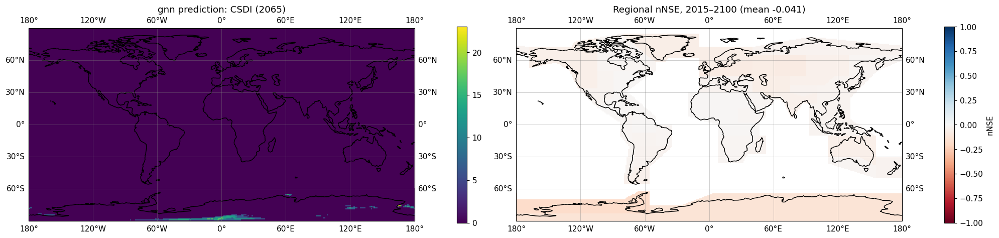</td>
  </tr>
  <tr>
<td align="center"><b>index_map_CWD_2065-01-01.png</b></td>
<td align="center"><b>index_map_FD_2065-01-01.png</b></td>
  </tr>
  <tr>
<td>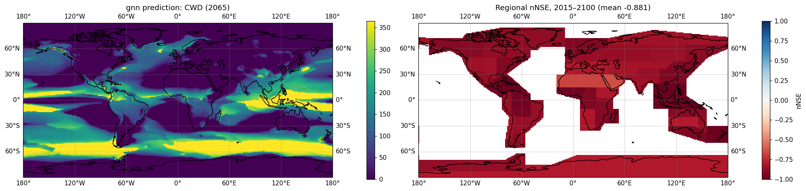</td>
<td>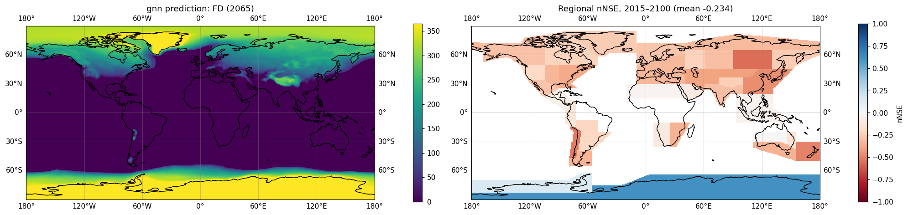</td>
  </tr>
  <tr>
<td align="center"><b>index_map_GSL_2065-01-01.png</b></td>
<td align="center"><b>index_map_ID_2065-01-01.png</b></td>
  </tr>
  <tr>
<td>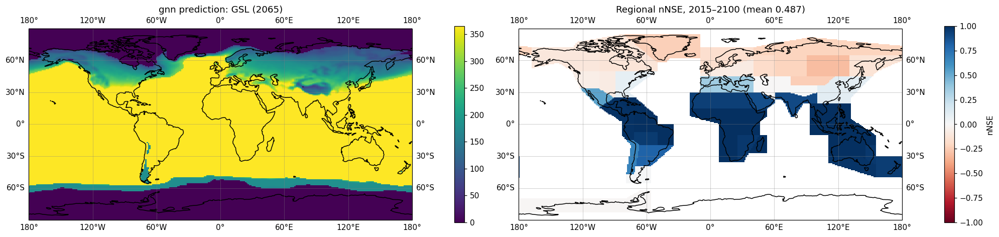</td>
<td>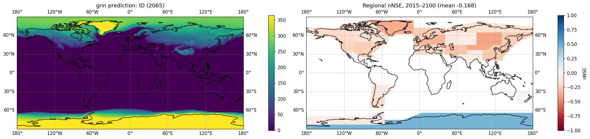</td>
  </tr>
  <tr>
<td align="center"><b>index_map_R10mm_2065-01-01.png</b></td>
<td align="center"><b>index_map_R95p_2065-01-01.png</b></td>
  </tr>
  <tr>
<td>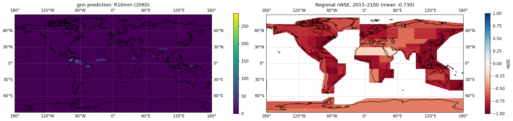</td>
<td>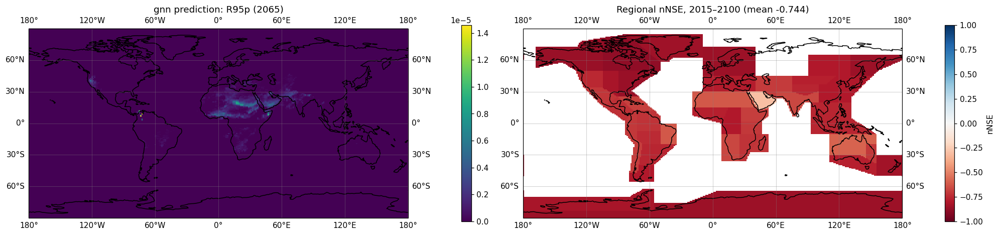</td>
  </tr>
  <tr>
<td align="center"><b>index_map_Rx5day_2019-03-01.png</b></td>
<td align="center"><b>index_map_SDII_2065-01-01.png</b></td>
  </tr>
  <tr>
<td>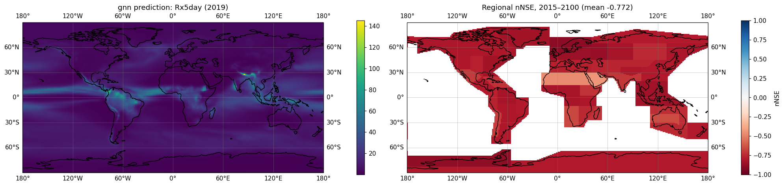</td>
<td>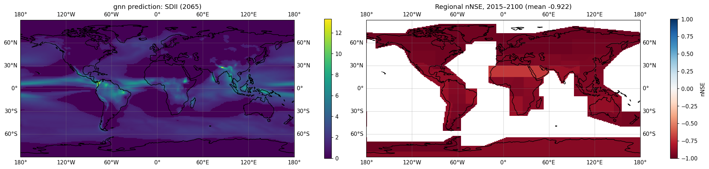</td>
  </tr>
  <tr>
<td align="center"><b>index_map_SU_2065-01-01.png</b></td>
<td align="center"><b>index_map_TNn_2019-03-01.png</b></td>
  </tr>
  <tr>
<td>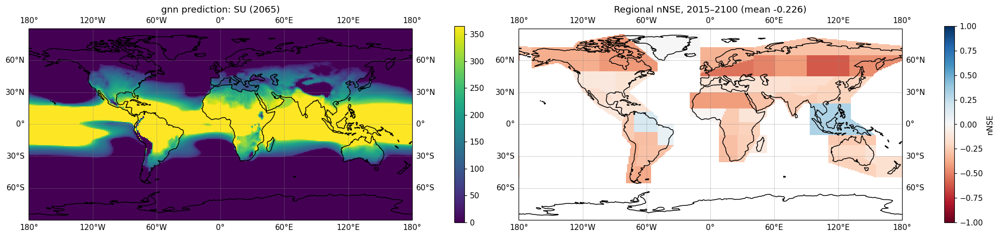</td>
<td>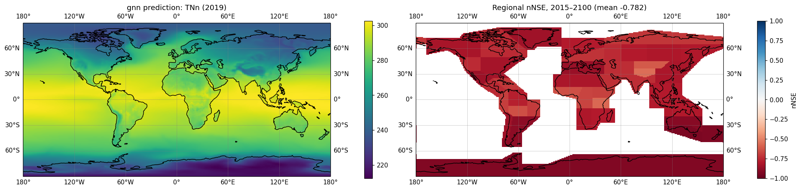</td>
  </tr>
  <tr>
<td align="center"><b>index_map_TR_2065-01-01.png</b></td>
<td align="center"><b>index_map_TXx_2019-03-01.png</b></td>
  </tr>
  <tr>
<td>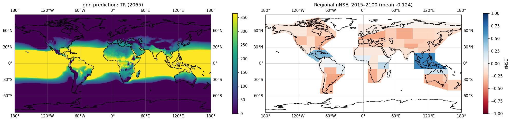</td>
<td>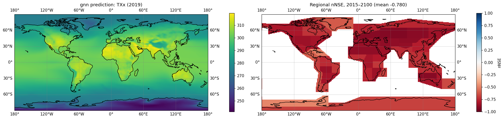</td>
  </tr>
  <tr>
<td align="center"><b>index_map_WSDI_2065-01-01.png</b></td>
<td align="center"></td>
  </tr>
  <tr>
<td>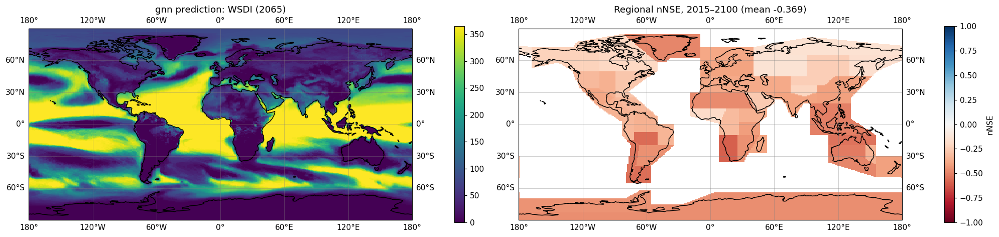</td>
<td></td>
  </tr>
</table>
